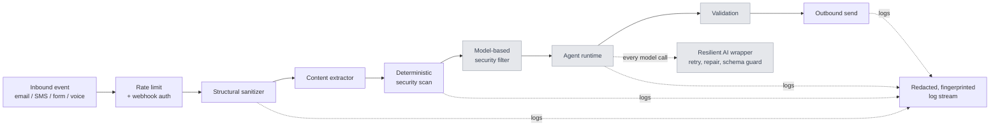

# Aeon Intelligence — Engineering Showcase

Selected infrastructure modules from the Aeon Intelligence platform, a multi-tenant AI agent system
that handles business communication across email, SMS, voice, and web forms. This repository is a
curated subset prepared for hiring evaluation. It is not the product, and it is not licensed for
use (see [LICENSE](LICENSE)).

The theme is **making LLM pipelines reliable in production**: getting untrusted text safely to a
model, getting well-formed output back, and keeping the surrounding system observable without
leaking customer data.

## What's here

| Area | Path | What it shows |
| --- | --- | --- |
| Model-call reliability | `src/llm-reliability/` | Structured-output repair, a schema guard for provider API constraints, a typed error taxonomy, and retry with backoff |
| Ingestion security boundary | `src/ingestion/` | Structural sanitization, a deterministic prompt-injection scan, per-event content extraction, and email quote stripping |
| Rate limiting and concurrency | `src/rate-limiting/` | A fail-open fixed-window limiter behind a store interface, a route decorator, a concurrency limiter, and an adaptive (AIMD) limiter |
| Privacy-safe observability | `src/observability/` | Two-layer log redaction with privacy tiers, and keyed HMAC fingerprints for phone numbers and email addresses |
| Route auth decorators | `src/auth/` | Composable decorators so route handlers contain zero auth code |
| Agent contracts | `src/agent/` | The typed boundary between the deterministic pipeline and the agent runtime |

## Architecture

The modules here sit on either side of the agent runtime ("Wilson"). Shaded stages are withheld
from this repository.



## Design principles you'll see in the code

- **Convergence points.** Cross-cutting behavior (retries, rate limits, auth, usage capture) lives
  where every code path already passes, not at each call site. Adding a route or a model call should
  never require remembering to add a guard.
- **Fail open vs. fail closed is deliberate.** The rate limiter fails open, so a storage outage never
  locks users out. Log redaction fails closed, so an unknown privacy tier is treated as the most
  restrictive.
- **Order-sensitive transformations are pinned by tests.** Quote stripping must run after HTML
  sanitization. See the ordering test in `tests/ingestion/email-quote-stripping.test.ts`.
- **The schema is the authority.** Output repair never guesses or coerces fields. It removes exactly
  one wrapper or does nothing.
- **Logs are a correlation index, not a content store.** Logs hold identifiers, counts, and keyed
  fingerprints. Message content lives once, in its canonical store.
- **Dependency inversion.** Storage, auth resolution, and tier lookup are injected interfaces, so the
  same modules run against a database in production and against in-memory fakes in tests.

## Running it

Requires Node.js 22 or later.

```bash
npm install
npm run typecheck
npm test
```

## What's intentionally not here

The agent runtime, prompts, tool implementations, knowledge catalog, validators, model-based security
stages, domain modules, database schema, and client configuration are proprietary and not included.
Where the showcase code touches them, a typed stub documents the contract and throws
`"Proprietary — available in a live walkthrough."`

I'm happy to walk through any of the withheld systems live, including design decisions, trade-offs,
and production incidents that shaped them.

---

© 2026 Quinten Knowles / Aeon Intelligence. All rights reserved.
